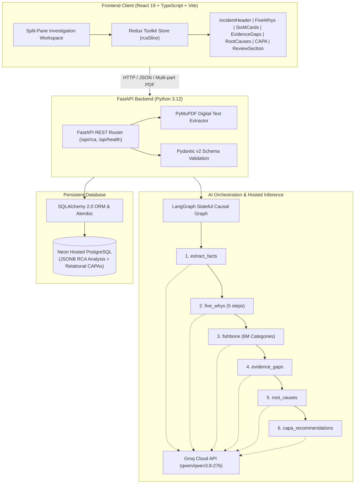

# AIVOA RCA Intelligence

**AI-Assisted Root Cause Analysis for Pharmaceutical API Manufacturing Deviations**  
*Built according to ICH Q7 (Good Manufacturing Practice for Active Pharmaceutical Ingredients), ICH Q9 (Quality Risk Management), and ICH Q10 (Pharmaceutical Quality System) methodologies.*

---

> **EVALUATION PROTOTYPE NOTICE & REGULATORY DISCLAIMER**  
> This application is a technical evaluation prototype developed for the AIVOA AI Product Engineer Challenge. It demonstrates causal reasoning, multi-stage LangGraph workflow orchestration, and structured pharmaceutical quality investigations.  
> **This software is NOT validated for commercial pharmaceutical release.** In accordance with **21 CFR Part 11**, formal GMP manufacturing sign-off requires cryptographically validated electronic signatures, authenticated role-based access controls (RBAC), and immutable audit trails, which are intentionally decoupled in this demonstration sandbox. All AI-generated findings must be treated as candidate hypotheses requiring independent physical verification by a Qualified Person (QP) or Quality Assurance authority.

---

## Architecture Overview



---

## Key Capabilities

1. **Multi-Source Incident Ingestion**: Accepts raw manufacturing incident text, batch record excerpts, deviation handover emails, or digital text-based PDF documents via PyMuPDF.
2. **Deterministic Multi-Stage LangGraph AI Workflow**:
   - **Fact Extraction**: Automatically normalizes product name, batch number, deviation report number, facility, unit operation, severity classification, and immediate containment actions.
   - **5 Whys Interrogation Chain**: Enforces exactly 5 sequential causal steps. If physical incident evidence runs out, remaining steps are explicitly flagged as *"Unresolved — Pending verification"* to prevent hallucinated certainty.
   - **6M Ishikawa Fishbone Analysis**: Maps contributing factors across all 6 manufacturing dimensions: Machine, Method, Material, Man, Measurement, and Milieu.
   - **Evidence Gap Identification**: Audits unverified logs, missing instrument calibration certificates, and unanswered chemical kinetics questions.
   - **Root Cause Formulation**: Formulates evidence-anchored hypotheses tagged with confidence levels, supporting data, and contradictory observations.
   - **ICH Q10 CAPA Synthesis**: Proposes targeted Corrective and Preventive Actions with assigned departmental owners, target completion timelines, and measurable effectiveness verification criteria.
3. **Enterprise Human-in-the-Loop Review**:
   - Full field-by-field acceptance or single-click sync of AI suggestions.
   - Interactive editing: add/remove 5-Whys steps, modify 6M factor tags, check off evidence gaps, update root cause statuses (Candidate → Confirmed / Ruled Out), and manage CAPAs.
4. **Relational & JSONB PostgreSQL Persistence**:
   - Saves reviewed investigations to Neon hosted PostgreSQL using JSONB for rich RCA trees and a relational table with foreign-key cascade for CAPA action items.
   - Reopens, edits, and updates past investigations via dedicated REST endpoints.

---

## Repository Structure

```text
AIVOA Assignment/
├── backend/
│   ├── alembic/                # Alembic migration scripts
│   ├── app/
│   │   ├── api/                # FastAPI routers (/api/health, /api/rca)
│   │   ├── core/               # App configuration and database engine
│   │   ├── models/             # SQLAlchemy ORM models (Investigation, CapaAction)
│   │   ├── schemas/            # Pydantic v2 schemas for requests & responses
│   │   └── services/           # Extractor (PyMuPDF) & LangGraph causal graph
│   ├── tests/                  # 12 automated integration and reliability tests
│   ├── .env.example            # Backend environment template
│   ├── requirements.txt        # Backend Python dependencies
│   ├── pyproject.toml          # Pytest configuration
│   └── verify_vertical_slice.py # E2E live smoke test script
├── frontend/
│   ├── src/
│   │   ├── components/         # Modular React components for all RCA sections
│   │   ├── store/              # Redux Toolkit store and rcaSlice
│   │   ├── types/              # Strict TypeScript interfaces matching backend schemas
│   │   ├── services/           # Typed API service clients
│   │   ├── App.tsx             # Main workspace layout
│   │   └── main.tsx            # React 19 entry point
│   ├── package.json            # Frontend dependencies (React 19, Tailwind v4, RTK)
│   ├── vite.config.ts          # Vite configuration with API proxy to localhost:8000
│   └── tsconfig.json           # TypeScript 6 strict configuration
├── samples/
│   ├── primary_incident_hplc_oos.txt  # Synthetic Atorvastatin OOS Impurity D scenario
│   └── sample_incident_report.pdf     # Text-based PDF incident report
├── docs/                       # Demonstration scripts and submission documentation
├── .env.example                # Root environment template
└── README.md                   # This documentation
```

---

## Setup & Execution Guide

### Prerequisites
- **Python**: Version 3.12+ installed
- **Node.js**: Version 20+ (with `npm`) installed
- **Git**: Installed
- **Groq API Key**: Free API key from [console.groq.com](https://console.groq.com)
- **Neon PostgreSQL Database**: Connection string from [neon.tech](https://neon.tech)

---

### Step 1: Clone the Repository & Configure Environment

```powershell
# Clone the repository
git clone https://github.com/Bhumika-Meena/RCA-Intelligence.git
cd "RCA-Intelligence"

# Copy the environment template
Copy-Item backend\.env.example backend\.env
```

Edit `backend/.env` with your credentials:
```ini
GROQ_API_KEY=gsk_your_actual_groq_api_key
GROQ_MODEL=qwen/qwen3.8-27b
DATABASE_URL=postgresql+psycopg2://<user>:<password>@<ep-xyz.region.aws.neon.tech>/<dbname>?sslmode=require
PORT=8000
HOST=0.0.0.0
CORS_ORIGINS=http://localhost:5173,http://127.0.0.1:5173
```

---

### Step 2: Backend Setup & Database Migrations

Open a terminal (PowerShell on Windows):

```powershell
cd backend

# Create and activate Python virtual environment
python -m venv .venv
.\.venv\Scripts\Activate.ps1

# Upgrade pip and install dependencies
pip install --upgrade pip
pip install -r requirements.txt

# Run Alembic migrations to create tables on Neon PostgreSQL
alembic upgrade head
```

---

### Step 3: Run Backend Automated Tests

Verify full database connectivity, health checks, CRUD endpoints, and edge-case reliability:

```powershell
# Run the complete test suite (12 tests)
pytest -v
```

Expected output:
```text
tests/test_database_integration.py::test_investigation_and_capa_roundtrip_persistence PASSED
tests/test_health.py::test_health_endpoint_healthy PASSED
tests/test_health.py::test_health_endpoint_database_unavailable PASSED
tests/test_rca_api.py::test_analyze_empty_payload_fails_gracefully PASSED
tests/test_rca_api.py::test_rca_crud_api_lifecycle PASSED
tests/test_reliability_and_errors.py::test_empty_incident_input_rejected PASSED
tests/test_reliability_and_errors.py::test_too_short_incident_input_rejected PASSED
tests/test_reliability_and_errors.py::test_empty_pdf_upload_rejected PASSED
tests/test_reliability_and_errors.py::test_scanned_pdf_without_text_rejected PASSED
tests/test_reliability_and_errors.py::test_nonexistent_investigation_returns_404 PASSED
tests/test_reliability_and_errors.py::test_patch_nonexistent_investigation_returns_404 PASSED
tests/test_reliability_and_errors.py::test_invalid_update_payload_rejected PASSED
============================= 12 passed in ~55s =============================
```

---

### Step 4: Frontend Setup & Build Verification

Open a second terminal window:

```powershell
cd frontend

# Install Node dependencies
npm install

# Verify TypeScript compilation and production build
npm run build
```

Expected output:
```text
✓ 1954 modules transformed.
✓ built in ~800ms
```

---

### Step 5: Launch Local Application

**Terminal 1 — Backend (FastAPI):**
```powershell
cd backend
.\.venv\Scripts\Activate.ps1
python -m uvicorn app.main:app --reload --port 8000
```
*Backend API available at: `http://localhost:8000` (Interactive Swagger docs at `http://localhost:8000/docs`)*

**Terminal 2 — Frontend (Vite):**
```powershell
cd frontend
npm run dev
```
*Frontend UI available at: `http://localhost:5173`*

---

## API Documentation

### 1. `GET /api/health`
Health check verifying both server liveness and Neon PostgreSQL database query capability.
- **Response `200 OK`**:
  ```json
  {
    "status": "healthy",
    "database": "connected",
    "timestamp": "2026-10-24T08:30:00Z"
  }
  ```

---

### 2. `POST /api/rca/analyze`
Extracts and analyzes raw incident text or digital PDF files via LangGraph and Groq.
- **Headers**: `Content-Type: application/json` OR `multipart/form-data`
- **Request Body (JSON mode)**:
  ```json
  {
    "text": "DEVIATION REPORT DEV-2026-0842: Atorvastatin Calcium Trihydrate API Batch ATC-2026-B089 reported OOS Impurity D (0.38% vs limit NMT 0.15%)...",
    "source_type": "pasted_text"
  }
  ```
- **Response `200 OK`**:
  Returns structured `AnalyzeResponse` containing `incident_facts`, 5 `five_whys` steps, all six `fishbone` categories, `missing_evidence` gaps, `root_causes`, and `capa_recommendations`.

---

### 3. `GET /api/rca`
Lists all saved investigations ordered by most recently modified.
- **Query Params**: `skip=0`, `limit=50`
- **Response `200 OK`**:
  ```json
  [
    {
      "id": 9,
      "deviation_number": "DEV-2026-0842",
      "title": "OOS Impurity D in Atorvastatin Calcium Trihydrate API",
      "product_name": "Atorvastatin Calcium Trihydrate",
      "batch_number": "ATC-2026-B089",
      "severity": "Critical",
      "status": "approved",
      "created_at": "2026-10-23T18:01:20Z",
      "updated_at": "2026-10-23T18:02:10Z",
      "capa_count": 2
    }
  ]
  ```

---

### 4. `POST /api/rca`
Persists a reviewed investigation and associated CAPA actions to Neon PostgreSQL.
- **Status `201 Created`**: Returns complete `InvestigationDetailResponse` with allocated database IDs.

---

### 5. `GET /api/rca/{id}`
Retrieves a complete investigation by ID, including its full RCA JSONB structure and relational CAPA items.

---

### 6. `PATCH /api/rca/{id}`
Updates editable fields, review status (`draft`, `under_review`, `approved`), reviewer notes, or CAPA action lists.

---

## RCA Methodology: Pharmaceutical Quality Context

| Investigation Component | Pharmaceutical & Regulatory Intent (ICH Q7 / Q9 / Q10) | Implementation in AIVOA RCA |
| :--- | :--- | :--- |
| **Incident Metadata** | Initial deviation capture and risk triage (Critical, Major, Minor). | Automated regex/LLM extraction of batch, product, deviation ID, unit operation, and quarantine actions. |
| **5 Whys Interrogation** | Root cause isolation by iteratively asking why process conditions drifted from validated state. | Strictly structured 5-step tree. Steps lacking physical evidence are flagged as *Unresolved* to prevent false confidence. |
| **Ishikawa 6M Fishbone** | Systematic evaluation of all manufacturing facets (Machine, Method, Material, Man, Measurement, Milieu). | All six categories are maintained. Categories without observed factors display *"No contributing factors observed in available evidence"*. |
| **Evidence Gap Audit** | Identifying missing analytical data, unverified logs, or calibration lapses before closing an inquiry. | Audits records and presents actionable checkboxes with priority ratings (High, Medium, Low). |
| **Root Cause Hypotheses** | Differentiating observed symptoms from underlying chemical or equipment failure mechanisms. | Hypotheses are kept in `candidate` status by default, displaying supporting evidence and contradictions side-by-side. |
| **CAPA Planning** | Preventing deviation recurrence across future batches through technical remediations. | Distinct Corrective Actions (immediate) and Preventive Actions (systemic) with owners, deadlines, and ICH Q10 effectiveness check criteria. |

---

## Known Limitations

1. **Text-Based PDF Intake Only (No Optical Character Recognition)**: The pipeline uses PyMuPDF for high-speed digital text extraction. Non-searchable scanned raster images reject gracefully with `422 Unprocessable Entity` rather than silent OCR hallucinations.
2. **Evaluation Prototype Authorization**: While the workflow provides a Qualified Person disposition panel, formal compliance with **21 CFR Part 11** requires authenticated identity management (RBAC), multi-factor authorization, and encrypted audit trails.
3. **No Automatic Batch Release Authority**: In compliance with cGMP principles, AI recommendations are advisory and cannot authorize commercial batch disposition without qualified human oversight.
